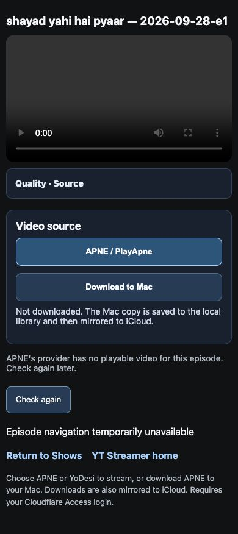

# APNE provider video missing — October 30, 2026

The reported episode is **Shayad Yahi Hai Pyaar — September 28, Episode 1**
(`shayad-yahi-hai-pyaar`, `2026-09-28-e1`). This change improves failure handling;
it does **not** restore the provider's missing video.

## Confirmed cause

The deployed Mac resolver and fresh `main` source at
`0519368fad8d22ddc0767fd376bd60b937b62ab9` match. Runtime logs and a fresh,
bounded replay of the exact APNE episode's handoff both reach the Mediagraming
player, which responds HTTP 200 with a 4,106-byte error document:

> Error: No master-playlist.m3u8 stream found.

There is no playable media URL in that response. The local parser correctly
refuses to invent one. The exact episode page exposes one Flash Link and no
PlayApne alternate. YoDesi's existing search API returned no exact show/date
match, and the show is outside its existing supported-show list. No adjacent
episode or unrelated video was substituted.

The exact public catalog page is
<https://apnetv.xyz/Hindi-Serial/show/286829/Shayad-Yahi-Hai-Pyaar>.
Upstream pages can change; this observation was made on October 30, 2026 CDT.

## Change

- Recognize the observed missing-playlist error page after supported HLS parsing
  fails and attach `APNE_UPSTREAM_VIDEO_MISSING` to the original error.
- Preserve PlayApne and configured YoDesi fallback attempts before returning a
  failure. Preserve source URL allowlists and text-only parsing.
- Report a static HTTP 502 JSON code/message through the authenticated source
  route and classify it as unavailable in source checks. Never send raw provider
  HTML, internal errors, or upstream media URLs to the player.
- For this code, pause the empty player, stop automatic retries, and show:
  “APNE's provider has no playable video for this episode. Check again later.”
  A manual **Check again** remains available with a minimum 44px touch height.
- Preserve bounded automatic recovery for transient failures and existing
  sign-in, source selection, HLS, MP4, and embedded playback behavior.

## Verification

- `npm run check`: passed.
- `npm test`: 700 passed, zero failures/skips.
- Independent read-only review: no material findings; targeted tests passed.
- Tests cover the full fixture handoff through the failed player, generic and
  HTTP 503 failures, legacy and XOR HLS parsing, successful PlayApne fallback,
  static route errors, no automatic retry for missing media, manual recheck,
  and normal recovery/source switching.
- A fresh fixed-resolver request to the reported upstream episode still returns
  the typed missing-video failure. **No playback restoration is claimed.**
- Local fixture in the existing **AMESH Google Chrome profile**: checked
  320×568, 375×812, 390×844, 430×932, 768×1024, and 844×390. All have zero
  horizontal overflow, a 44px recheck target, visible 48px quality disclosure,
  and a paused empty player. One initial request and one manual recheck produced
  exactly two source requests. Classic/New main shells also had zero overflow
  at all six sizes. This was Chrome viewport verification, not real iPhone
  Safari or Tesla acceptance. The standalone headless mobile script was not
  used; these measurements used the user's existing signed-in Chrome profile.

Responsive measurements: [JSON](evidence/apne-source-missing-20261030.json).

## Release state and remaining work

Branch: `fix/apne-source-resolution-20261030`, based on the current shared main.
This patch applies to both Mac and StreamHA application source. It has not been
merged, published as a release, installed, or deployed. Mac production remained
at `0519368fad8d22ddc0767fd376bd60b937b62ab9`; the four affected production
application files still match that baseline. No runtime data, services,
authentication, or device settings were changed.

**Playback blocker:** the external provider must restore this exact episode's
video or offer a verifiable replacement. Deployment of this patch improves the
message/retry behavior but cannot supply that missing video. Shared CI is
tracked on the draft PR. Any later release still requires the shared release
gate and explicit deployment authorization, then real iPhone/Tesla acceptance.
