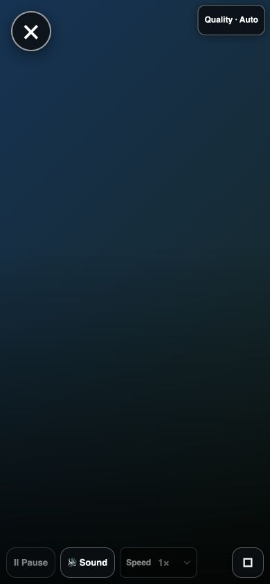

# Fullscreen controls fix — development only

User request: hide the remaining controls during fullscreen, improve Tesla fullscreen entry, and **do not deploy**.

Base: shared main `3312c44948e98ea8dc69edf3156380b9ce888b2c`.
Branch: `fix/fullscreen-clean-controls-20261101`.

## Behavior

- The existing user-triggered native fullscreen request now prefers `navigationUI: "hide"`. A rejected, absent, or silent no-op native API uses the existing in-page fallback, labeled **Exit expanded player**, with a brief nonblocking explanation.
- Native fullscreen is reported only after the player is observed as the fullscreen element. The legacy WebKit path waits briefly for its event. Exit intent cancels stale fallback completion and exits a late native entry for this player; unrelated fullscreen elements are left alone.
- While fullscreen is active, the AI account panel and reopen button are visually suppressed without changing consent, authentication, or controller state. Their ordinary visibility state returns on exit.
- During uninterrupted playback, the existing five-second idle timeout now hides Quality and popup-close as well as the player overlay/badge. One tap reveals controls without pausing. Paused/loading/error states and active interactions retain controls. Keyboard-visible focus keeps controls visible; focus reveals the controls again.
- Quality is at least 44px high. Its existing behavior is preserved: selecting Quality leaves fullscreen and opens the panel beside the active player. Source-controlled quality remains explained.
- Fullscreen popup-close moves to the upper left so it does not overlap Quality at the upper right. The normal non-fullscreen layout is preserved.

## Verification

- `npm run check`: passed.
- `npm test`: **711/711 passed**, no failures/skips.
- `node --test test/fullscreen-autohide.test.mjs`: **14/14 passed**, including native success/rejection/no-op, legacy WebKit, late entry after Exit, stale rejection after Exit, and unrelated fullscreen preservation.
- Independent read-only review: earlier race and selector issues resolved; no remaining actionable production defect in the final request/exit handling.
- Existing signed-in **AMESH Google Chrome**, local fixture only: Classic and New at 320×568, 375×812, 390×844, 430×932, 768×1024, 844×390, and 1280×800. **14/14 behavior combinations passed**. Final placement recheck after the Close/Quality separation: **14/14**, zero horizontal overflow, targets in bounds, no overlap, minimum 44px targets.
- Actual Chrome interaction at 390×844: click Fullscreen, wait 5.6 seconds, observe idle with retained pointer focus, hidden Quality/Close/AI and overlay opacity zero; click player to reveal. Keyboard Tab to Quality kept it visible beyond five seconds; Enter opened the quality panel and left expanded mode without pausing.
- The fixture simulates native fullscreen success and rejection. The real Chrome click selected the expanded fallback in this automation session. **Native Tesla chrome hiding, real iPhone Safari, and real media/audio acceptance are unverified.** No claim that a website can force Tesla's URL bar away.
- The repository's existing `mobile-player-browser-check.mjs` runs in shared CI; local responsive checks used the owner's requested Chrome profile rather than launching a new profile.

## Reproduce the focused browser fixture

From `webapp`, run `node scripts/fullscreen-clean-controls-browser-check.mjs --serve`. Open the printed loopback URL in the signed-in Chrome profile, choose `?ui=classic` or `?ui=new`, set a required viewport, and press **Run fullscreen checks**. APIs return fixture data; the served AI script's hostname guard is removed only in memory for this loopback test. Production sources retain the guard. The native-event tests are simulated; use an actual user click separately to test browser acceptance. Stop with Ctrl+C.

Evidence in [evidence/fullscreen-20261102](evidence/fullscreen-20261102/): responsive results, final geometry, actual-click measurements, and 390px screenshots. The gradient is a local playback-state fixture, not a decoded video.

| Idle expanded player | Controls revealed |
| --- | --- |
|  |  |

## Release boundary

Draft source only. No merge, production installation, service restart, release publication, or Mac/HA runtime edits. Both hosts require the same shared release after separate authorization and green shared gates. Before later release, check the latest main and rerun affected checks if it changed. Physical iPhone/Tesla acceptance follows an authorized installation.
